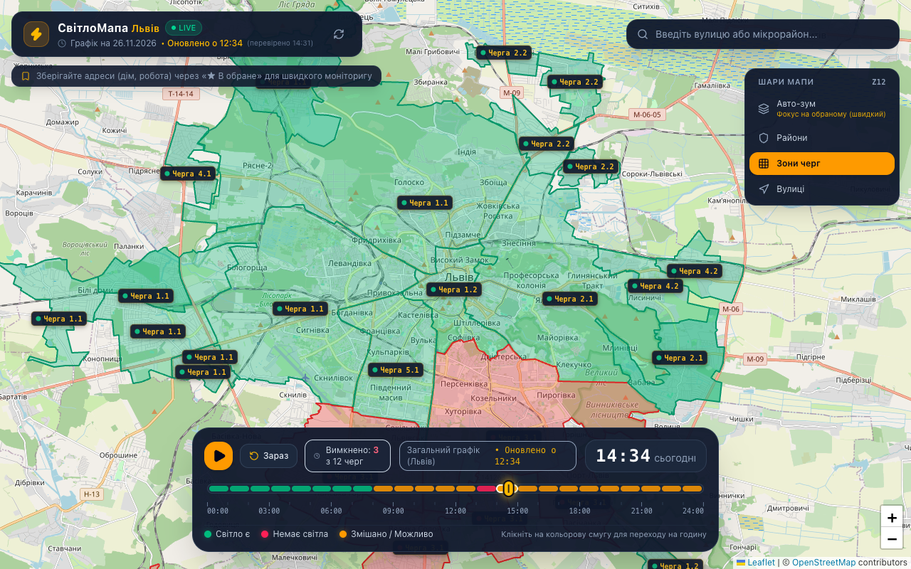
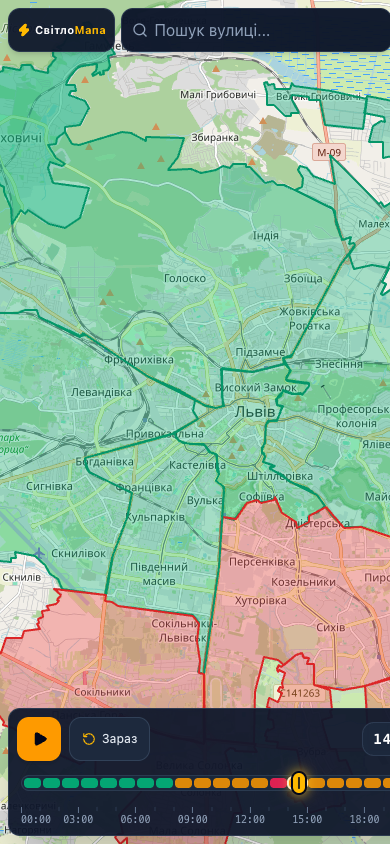

# СвітлоМапа Львів (Power Map Lviv)

Веб-застосунок для інтерактивного моніторингу графіків погодинних відключень електроенергії у Львові з прив'язкою до адміністративних районів, зон черг (підгруп 1.1–6.2) та конкретних вулиць. Працює як повноцінний автономний застосунок (PWA) з підтримкою офлайн-режиму на смартфонах.

Демо онлайн: [https://magshproget.github.io/power-map/](https://magshproget.github.io/power-map/)

---

## Інтерфейс

### Десктопна версія


### Мобільна версія
<p align="center">
  
</p>

---

## Встановлення застосунку на смартфон (PWA)

Застосунок оптимізовано для роботи у повноекранному автономному режимі без встановлення через App Store чи Google Play.

### iOS (iPhone / iPad):
1. Відкрийте посилання [https://magshproget.github.io/power-map/](https://magshproget.github.io/power-map/) у браузері **Safari**.
2. Натисніть кнопку **"Поділитися"** (квадрат зі стрілкою вгору по центру нижньої панелі).
3. Прокрутіть меню вниз і виберіть пункт **"На початковий екран"** (Add to Home Screen).
4. У правому верхньому куті натисніть **"Додати"**.
5. На головному екрані з'явиться іконка "СвітлоМапа". Застосунок запускається в окремому вікні без рамок браузера і продовжує показувати карту та графіки навіть під час повного зникнення мобільного зв'язку (офлайн-кеш).

### Android:
1. Відкрийте [https://magshproget.github.io/power-map/](https://magshproget.github.io/power-map/) у браузері **Google Chrome**.
2. Натисніть кнопку меню (три крапки у правому верхньому куті).
3. Виберіть пункт **"Встановити додаток"** або **"Додати на головний екран"**.
4. Підтвердіть встановлення. Іконка з'явиться у списку додатків та на робочому столі.

---

## Основні можливості

1. Багаторівнева векторна мапа (Canvas Level of Detail):
   - Огляд міста: 6 адміністративних районів (Галицький, Франківський, Шевченківський, Сихівський, Личаківський, Залізничний).
   - Середній масштаб: контурні зони підгруп черг (1.1 - 6.2).
   - Детальний масштаб: точкові лінії вулиць та будинків із лінивим підвантаженням геометрій.
2. 24-годинний інтерактивний таймлайн:
   - Математично вирівняна шкала годин (00:00 - 24:00) з точними відмітками між слотами.
   - Кнопка "Зараз" для миттєвої синхронізації з поточним часом доби.
   - Режим анімації доби для наочного перегляду чергування вимкнень.
   - Колірне кодування: зелений (струм є), червоний (відключено), жовтий (часткове / можливе).
3. Детальна картка локації (Details Drawer):
   - Офіційний статус від Львівобленерго та текстовий опис графіка.
   - Клікабельна 24-годинна стрічка з можливістю тапу на будь-яку годину.
   - Стрілки крокового перемикання годин безпосередньо всередині мобільної картки.
   - Список ключових вулиць обраної зони з швидким фокусуванням на карті.
4. Живий пошук:
   - Дебаунс та відкладений рендер (`useDeferredValue`) за базою з понад 3 100 вулиць Львова.
   - Автофокусування камери карти без конфліктів анімації.
5. Збережені локації:
   - Можливість додати район або вулицю в обране з присвоєнням мітки ("Дім", "Робота", "Батьки").
   - Панель швидкого доступу до збережених точок для моніторингу в один клік.
6. Офлайн-робота (Service Worker):
   - Стратегія Network-First для HTML гарантує отримання свіжої версії без залипання старих збірок.
   - Стратегія Stale-While-Revalidate для файлу графіка `schedule.json` забезпечує миттєве відкриття збереженого розкладу під час блекаутів із фоновим оновленням за наявності зв'язку.
   - Cache-First для статичних чанків та геоданих.

---

## Джерела даних

- Актуальний розклад відключень автоматично оновлюється з офіційного API Львівобленерго (`/api/loe/menus?page=1&type=photo-grafic`) за допомогою періодичного GitHub Actions workflow (кожні 10 хвилин).
- Автономний fallback-кеш у кодовій базі на випадок збоїв API або відсутності інтернету.

---

## Розробка та запуск

```bash
# Встановлення залежностей
npm install

# Завантаження свіжого графіка
npm run fetch:schedule

# Запуск dev-сервера з проксі до API Львівобленерго
npm run dev

# Збірка production-бандла
npm run build

# Попередній перегляд зібраного проекту
npm run preview
```

---

## Технологічний стек

- React 18, TypeScript, Vite 6
- Leaflet з рендерингом векторних шарів на Canvas (`preferCanvas`)
- Tailwind CSS 4
- Lucide React (іконки)
- PWA / Service Worker (Cache API, Web App Manifest)
